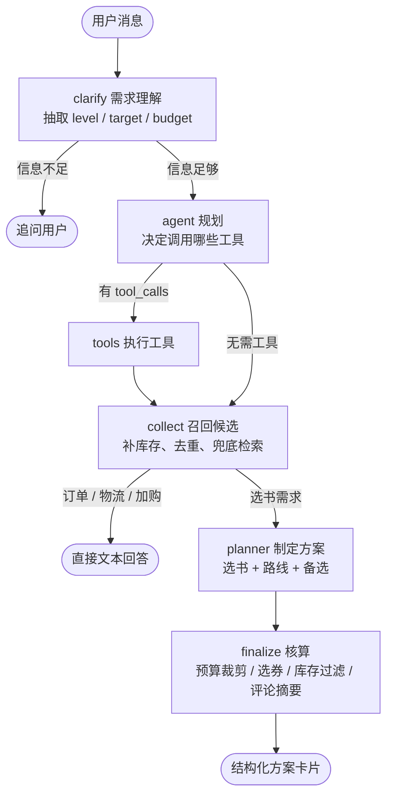

# BookWise · AI 图书导购系统

一个把「选书」交给大模型的图书商城 Demo：用户说清楚基础、方向和预算，AI 自主调用检索、比价、库存、评论、优惠券等工具，给出带学习路线的购书方案，并支持多轮微调、一键加购与下单。

前后端分离，FastAPI + LangGraph 负责业务与智能体编排，Vue 3 + Vite 负责界面，MySQL 8 存储数据，Docker Compose 一键部署。


---

## 目录

- [功能特性](#功能特性)
- [技术栈](#技术栈)
- [项目结构](#项目结构)
- [快速开始](#快速开始)
- [环境变量](#环境变量)
- [AI 导购工作流](#ai-导购工作流)
- [核心 API](#核心-api)
- [数据库表](#数据库表)
- [工程实现要点](#工程实现要点)
- [已知限制与后续计划](#已知限制与后续计划)

---

## 功能特性

### 商城侧

| 模块 | 说明 |
| --- | --- |
| 图书列表 | 关键词（书名 / 作者 / 标签）搜索，按难度（入门 / 进阶 / 实战）筛选 |
| 账号体系 | 注册登录、修改用户名、上传头像（前端压缩到 512px 后以 dataURL 提交） |
| 购物车 | 加购、改数量、删除、只结算选中条目 |
| 优惠券 | 满减 / 折扣两类，按门槛与有效期过滤，自动推荐最省的一张 |
| 下单支付 | 创建订单 → 模拟支付 → 扣减库存，库存不足在写库前整单拦截 |
| 订单与物流 | 订单列表、明细、状态流转，支付后写入物流时间线并可查询 |

### AI 导购侧

- **需求理解**：从自然语言中抽取 `level`（基础）、`target`（方向）、`budget`（预算）、`preference`（偏好）；信息不足时反问补全。
- **工具调用**：9 个 LangChain Tool 覆盖检索、库存、比价、优惠券、评论、预算、加购、订单、物流，由模型自行决定调用顺序。
- **结构化方案**：选书清单 + 推荐理由 + 学习路线 + 备选书目 + 预算 / 优惠 / 实付明细。
- **硬约束落地**：预算超出的书自动移入备选、缺货书不进清单、金额一律由后端计算而非模型口算。
- **多轮微调**：「第二本换成实战书」「总价压到 150」「只要一本」都能基于上一轮方案做最小改动。
- **流式思考过程**：`SSE` 把每个节点的真实执行情况推给前端，界面逐步展示「理解需求 → 规划检索 → 调用工具 → 召回候选 → 制定方案 → 核算金额」。

## 技术栈

| 层次 | 选型 |
| --- | --- |
| 后端 | Python 3.11、FastAPI、Uvicorn、SQLAlchemy 2.x、PyMySQL |
| 智能体 | LangChain、LangGraph（`StateGraph` + `ToolNode`）、DeepSeek `deepseek-chat` |
| 前端 | Vue 3（`<script setup>` 单文件组件）、Vite 8、原生 CSS |
| 数据库 | MySQL 8.0（utf8mb4） |
| 部署 | Docker Compose、Nginx（静态资源 + `/api` 反向代理） |

## 项目结构

```
.
├── backend/                 # FastAPI 服务
│   ├── main.py              # 路由层：接口定义、参数校验、HTTP 状态码
│   ├── service.py           # 业务层：纯函数，返回 dict，不抛 HTTP 异常
│   ├── models.py            # SQLAlchemy ORM 模型
│   ├── database.py          # 引擎、Session、get_db 依赖
│   ├── agent.py             # LangGraph 智能体：工具、节点、流式入口
│   ├── uploads/avatars/     # 用户头像（不进版本库）
│   ├── requirements.txt
│   └── Dockerfile
├── frontend/                # Vue 3 前端
│   ├── src/
│   │   ├── App.vue          # 布局、导航、图书页
│   │   ├── api.js           # fetch 封装、登录态 localStorage
│   │   ├── style.css        # 全局样式与设计变量
│   │   └── components/
│   │       ├── AuthView.vue     # 登录 / 注册
│   │       ├── ChatView.vue     # AI 导购对话与思考过程
│   │       ├── PlanCard.vue     # 结构化购书方案卡片
│   │       ├── CartView.vue     # 购物车与结算
│   │       ├── OrderView.vue    # 订单、支付、物流
│   │       ├── ProfileView.vue  # 个人资料、头像
│   │       └── Icon.vue         # 内联 SVG 图标
│   ├── nginx.conf
│   └── Dockerfile
├── sql/init.sql             # 建库建表 + 种子数据（约 50 本书、价格、库存、评论、优惠券）
├── docker-compose.yml       # mysql + backend + frontend 三段编排
├── .env.example
└── README.md
```

## 快速开始

### 前置要求

- Docker 与 Docker Compose（推荐路径）
- 或本地：Python 3.11+、Node.js 18+、MySQL 8.0+
- 一个 [DeepSeek](https://platform.deepseek.com/) API Key（AI 导购必需，其余功能不依赖）

### 方式一：Docker Compose（推荐）

```bash
# 1. 准备环境变量
cp .env.example .env
# 编辑 .env，至少填入 DEEPSEEK_API_KEY、DB_PASSWORD、MYSQL_ROOT_PASSWORD

# 2. 构建并启动
docker compose up -d --build

# 3. 访问
#    前端        http://localhost
#    接口文档    http://localhost/docs
```

启动顺序由 `healthcheck` 保证：MySQL 就绪后才拉起后端，后端起来后才启动 Nginx。`sql/init.sql` 在数据库数据卷为空时自动执行一次，无需手动导表。

> 如果修改了 `init.sql` 需要重新初始化，可先 `docker compose down -v` 再启动。该命令会删除数据卷，**已有数据会丢失**，请谨慎执行。

### 方式二：本地开发

**1）数据库**

```bash
mysql -u root -p < sql/init.sql
```

**2）后端**

```bash
cd backend
python -m venv .venv
# Windows
.venv\Scripts\activate
# macOS / Linux
source .venv/bin/activate

pip install -r requirements.txt
cp .env.example .env      # 填写数据库账号密码与 DEEPSEEK_API_KEY
uvicorn main:app --reload --host 127.0.0.1 --port 8000
```

**3）前端**

```bash
cd frontend
npm install
npm run dev               # 默认 http://localhost:5173
```

Vite 已配置 `/api` 代理到 `http://127.0.0.1:8000`，本地开发无需处理跨域。

## 环境变量

仓库根目录 `.env` 供 `docker compose` 变量插值使用；`backend/.env` 供本地直接运行后端时使用，两者内容基本一致。

| 变量 | 位置 | 说明 |
| --- | --- | --- |
| `MYSQL_ROOT_PASSWORD` | 根 `.env` | MySQL root 密码，仅 Compose 使用 |
| `DB_HOST` / `DB_PORT` | 两者 | 数据库地址。容器内由 Compose 覆盖为 `mysql:3306` |
| `DB_USER` / `DB_PASSWORD` | 两者 | 业务账号；Compose 会用它创建 MySQL 用户 |
| `DB_NAME` | 两者 | 库名，默认 `bookmall` |
| `DEEPSEEK_API_KEY` | 两者 | DeepSeek API Key，缺失时 AI 接口返回「AI 服务未配置」 |

`.env` 已在 `.gitignore` 中，**不要把真实密钥提交到仓库**。

## AI 导购工作流

`backend/agent.py` 用 LangGraph 把导购拆成 6 个节点，条件边负责分流：



| 节点 | 职责 |
| --- | --- |
| `clarify` | 抽取用户画像，判断是否需要追问；识别「微调」与「查询类指令」，避免不必要反问 |
| `agent` | 带 `bind_tools` 的 LLM，自主决定检索 / 库存 / 比价 / 券 / 评论 / 加购 / 订单 / 物流的调用 |
| `tools` | `ToolNode` 执行工具，结果以 JSON 回流 |
| `collect` | 汇总工具返回的图书；模型漏调工具时按目标关键词兜底检索；补齐库存 |
| `planner` | 在候选内选 1~3 本，产出推荐理由、学习路线、备选书目 |
| `finalize` | 预算裁剪、库存过滤、自动选最省券、汇总评论，统一算出实付金额 |

模型不可靠的地方全部由后端兜底：模型没给 `selected_ids` 时按评分贪心挑书并控制预算；模型算错金额时以 `service` 层计算结果为准；模型编造的书名因无法在候选中匹配而不会进入清单。

**多轮会话**保存在进程内字典 `_sessions`（含对话历史、画像、上一轮方案），适合答辩演示；生产环境可替换为 Redis。

## 核心 API

| 方法 | 路径 | 说明 |
| --- | --- | --- |
| GET | `/api/books` | 图书列表，支持 `keyword`、`level` |
| GET | `/api/books/{id}/stock` | 库存查询 |
| GET | `/api/books/{id}/prices` | 京东 / 当当 / 淘宝比价 |
| GET | `/api/books/{id}/reviews` | 图书评论 |
| GET | `/api/coupons` | 按金额查可用优惠券 |
| POST | `/api/users/register` / `login` | 注册 / 登录 |
| GET·PATCH·DELETE | `/api/users/{id}` `/avatar` | 资料、头像读写 |
| POST | `/api/cart/add` | 加入购物车 |
| GET | `/api/cart/{user_id}` | 购物车列表 |
| GET | `/api/cart/{user_id}/summary` | 金额汇总（可只算选中条目 + 指定券） |
| POST | `/api/orders/create/{user_id}` | 创建订单（可只结算选中条目） |
| GET | `/api/orders/{user_id}` | 订单列表 |
| POST | `/api/orders/{order_id}/pay` | 模拟支付（幂等） |
| GET | `/api/orders/{order_id}/logistics` | 物流轨迹 |
| POST | `/api/chat` | AI 导购（一次性返回） |
| POST | `/api/chat/stream` | AI 导购（SSE 流式，含思考过程） |

统一响应格式为 `{"code": 200, "data": ...}`；业务异常以 4xx + `detail` 返回，前端 `api.js` 会把 `detail` 转成可读提示。

## 数据库表

| 表 | 作用 |
| --- | --- |
| `books` | 图书主数据（书名、作者、分类、难度、评分、标价、标签） |
| `book_prices` | 各平台价格，用于比价 |
| `inventory` | 库存，一书一行 |
| `reviews` | 评论，供 AI 生成评论摘要 |
| `coupons` | 优惠券（满减 / 折扣、门槛、有效期） |
| `users` | 用户，密码以 PBKDF2 加盐哈希存储 |
| `cart_items` | 购物车，`(user_id, book_id)` 唯一 |
| `orders` / `order_items` | 订单主表与明细，记录原价、实付、用券 |
| `logistics` | 物流节点时间线 |

种子数据包含约 50 本计算机类图书、三平台价格、库存（其中 3 本故意设为 0 用于演示缺货）、评论与 8 张优惠券。

## 工程实现要点

- **分层清晰**：`main.py` 只做参数与 HTTP 语义，`service.py` 是纯业务函数（返回 dict、抛 `ValueError`），`agent.py` 只做智能体编排，避免业务逻辑散落。
- **算价口径唯一**：`service.apply_coupon` / `pick_best_coupon` 被方案卡片、购物车汇总、创建订单三处共用，杜绝「页面一个价、下单另一个价」。
- **防超卖**：下单时对库存行 `with_for_update()` 加锁，把「先查再减」变成原子操作；任一本书不足则整单拒绝，且在写库前校验，不产生半张订单。
- **密码安全**：PBKDF2-SHA256 + 独立盐，存储格式 `盐$哈希`，比对用 `hmac.compare_digest`；历史空密码账号首次登录时绑定密码。
- **SSE 流式**：后端按节点产出 `step` / `result` / `error` 三类事件，前端用 `fetch + ReadableStream` 解析，结果到达后思考面板自动折叠成一行。
- **金额用 `Decimal`**：所有价格计算避免浮点误差，统一 `ROUND_HALF_UP` 保留两位。
- **容器化细节**：后端 `uploads` 目录挂载到宿主机，重建容器不丢头像；Nginx 额外转发 `/docs`、`/openapi.json`，否则会被 `try_files` 兜底成 `index.html`。

## 已知限制与后续计划

当前定位是课程 / 演示项目，以下是有意简化或尚未完成的部分：

- 鉴权为前端 `localStorage` 存 `user_id`，接口不校验身份，**仅适合本地演示**；后续计划改为 JWT + 后端会话校验。
- 会话状态存于进程内字典，多 worker 或多实例部署时会丢失；计划迁移到 Redis。
- 支付为模拟状态流转，无真实支付回调与对账。
- 图书与比价数据来自 `init.sql` 静态种子，未接入真实电商接口。
- 尚无自动化测试；计划为 `service` 层补 pytest 用例（下单、用券、库存并发）。

## License

本项目仅用于学习与技术演示，未附带开源许可证。如需引用或二次分发，请先联系作者。
